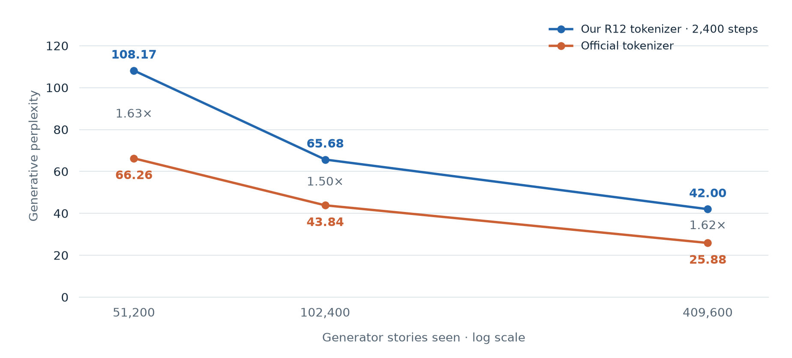
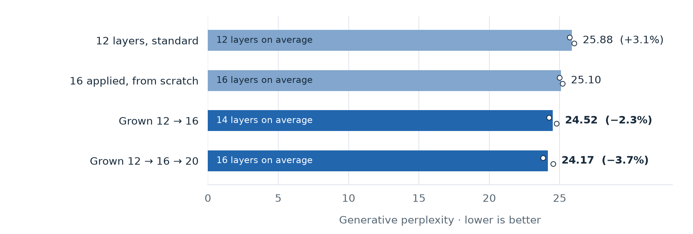

# Training a Next-Concept Model on a single 12 GB GPU

**Gianluca Meola** · Research note v0.2 · 23 November 2026 (v0.1: 20 November 2026 UTC)  
[Read the paper (PDF)](paper/ncm-12gb.pdf) · [Experiments](EXPERIMENTS.md) · [Reproduce the results](REPRODUCING.md) · [Contact](mailto:gianluca.meola89@gmail.com)  
[](https://doi.org/10.5281/zenodo.24408540) [](https://huggingface.co/janlu89/ncm-12gb)

> **Latest update — v0.2 · 23 November 2026**
>
> - **New:** a looped generator (a shared block of layers applied several times) can be grown in depth during training without a measurable loss of quality (no difference beyond the 4.7% two-seed threshold), at equal or lower compute counted as applied layers averaged over steps: 24.52 (grown 12 → 16) and 24.17 (grown 12 → 16 → 20, ending at 20 applied layers) against 25.10 for the 16-applied-layer model trained from scratch (two seeds, 409,600 stories). → [Section 4](#4-a-looped-generator-can-be-grown-in-depth--new-in-v02)
> - **Not shown:** that growth *improves* quality. Both two-seed comparisons are ties under the 4.7% rule for two-seed means, fixed before the second-seed runs; each single-seed comparison is within the 6.7% single-run threshold; all four favour growth.
> - **Negative:** two more tokenizer interventions (relative dead-code restart threshold, slower codebook EMA decay) made generation worse. The tokenizer gap is still **1.39×**.
> - **Unchanged:** every v0.1 result and conclusion below. Full list of changes: [CHANGELOG.md](CHANGELOG.md).

> **Which official checkpoint.** In this study, "official tokenizer" and "official generator" always mean the authors' TinyStories release of 14–16 October 2026 (`hazyresearch/ncm-checkpoints`, revision `d342ce8aaea58830eef3b8ad473664673e41f692`; v0.1 and v0.2 alike). On 23 November 2026 the authors replaced these files with a new release; it was not evaluated here. See [REPRODUCING.md](REPRODUCING.md) for the pinned revision and file hashes.

**Version history**

| Version | Date | What's new | Conclusions changed? | DOI |
|:---|:---|:---|:---|:---|
| **v0.2** | 23 Nov 2026 | Looped generator grown in depth; two negative tokenizer tests; WSD and descent-branch tooling (not yet used) | No; one finding added | [10.5281/zenodo.24478988](https://doi.org/10.5281/zenodo.24478988) |
| [v0.1](https://github.com/janlu89/ncm-12gb/tree/v0.1) | 20 Nov 2026 (UTC), archived on Zenodo 21 Nov | Initial release: data-initialised codebooks, retuned short-budget recipe, remaining 1.39× tokenizer gap | — | [10.5281/zenodo.24408541](https://doi.org/10.5281/zenodo.24408541) |

**How far can a Next-Concept Model get on one consumer GPU?** This study trains the tokenizer and generator on TinyStories, tests practical choices at small budgets, and documents the remaining gap to the authors' released tokenizer. The main result is a reproducible account of what helps, with the unsuccessful interventions and raw runs included. Version 0.2 adds a looped generator that can be grown in depth during training, and two more tokenizer interventions that did not help.

| Finding | Measured change | Scope |
|:---|:---|:---|
| Initialise codebooks from data | **48% lower Gen. PPL** | 222.78 → 115.38; two generator seeds, one tokenizer per configuration |
| Retune the short-budget generator | **56% lower Gen. PPL** | 150.67 → 66.26; two generator seeds, official tokenizer |
| Train our tokenizer longer | **A 1.39× gap remains** | 92.35 versus 66.26; two tokenizer seeds at the longest budget |
| *New in v0.2* · Grow a looped generator in depth during training | **No measurable loss of quality, equal or lower compute** (applied layers averaged over steps) | 24.52 and 24.17 versus 25.10 for 16 applied layers from scratch; ties under the 4.7% two-seed rule fixed before the second-seed runs; two seeds, official tokenizer, 409,600 stories |

The first three comparisons use a generator trained on **51,200 stories**; the third uses different seed types on each side. The growth comparison uses **409,600 stories**. Details below. Gen. PPL is generative perplexity under GPT-2 large, **lower is better**. These percentages describe this metric, not equivalent percentage gains in general text quality.

### Best generator so far · *New in v0.2*

Records of **this study**, on the official tokenizer with the improved recipe (constant corruption 0.5, FlexAttention, lr 1e-3), at a fixed budget of **409,600 stories** (3,200 steps × 128). Each value is the mean of two training seeds. These are not the authors' full-budget model: the paper reports 15.41 after about 102.4M stories, and their October 2026 release scores 16.58 in this evaluation.

| # | Gen. PPL | Change | Date | Runs |
|---:|---:|:---|:---|:---|
| 1 | 25.88 | 12-layer standard generator (v0.1) | 20 Nov 2026 | `gen-tokuff_409600_3200x128_c50_lr1e-3_flex_s42`, `_s43` |
| 2 | 25.10 | Looped generator, 16 applied layers, trained from scratch (−3.0%; more compute than #1) | 23 Nov 2026 | `…_flex_cicli4-4x2-4_s42`, `_s43` |
| 3 | 24.52 | Grown 12 → 16 applied layers at step 1,600 (−2.3% vs #2, with 12.5% fewer applied layers) | 23 Nov 2026 | `…_flex_cicli4-4x2-4-cresce1600_s42`, `_s43` |
| 4 | **24.17** | Grown 12 → 16 → 20 at steps 1,067 and 2,133, ending at 20 applied layers (−1.4% vs #3; same average number of applied layers as #2) | 23 Nov 2026 | `…_flex_cicli4-4x3-4-cresce1067-2133_s42`, `_s43` |

Consecutive records differ by less than the study's 4.7% threshold for two-seed means; #3 and #4 against #1 (−5.3% and −6.6%) exceed it, both with more compute (14 and 16 applied layers on average against 12). Run names abbreviated with `…` start with `gen-tokuff_409600_3200x128_c50_lr1e-3`. At the 51,200-story budget the best two-seed mean is 66.26 for the standard generator (v0.1) and 64.58 for the generator grown 12 → 16 (v0.2, seeds 60.91 and 68.25: a tie).

> **Scope:** a study of training at small budgets on an RTX 3080 Ti (12 GB), not a full reproduction of the NCM paper. Maximum training exposure is 9.83M stories for our tokenizer and 0.41M for our generator, versus 122.88M and 102.4M reported in the paper (the training budgets of the released checkpoints are not stated separately). Stories seen are a data-exposure measure, not unique examples or a matched compute budget.

## What is an NCM?

[Next-Concept Models](https://arxiv.org/abs/2610.14162) generate text from coarse to fine. A VQ-VAE tokenizer compresses a story into a hierarchy of discrete codes. A separate generator learns to predict that hierarchy level by level, and the tokenizer's decoder turns the codes back into text.

<p align="center">
  <picture>
    <source media="(prefers-color-scheme: dark)" srcset="figures/coarse_to_fine_dark.gif">
    
  </picture>
</p>

The animation shows the hierarchy at work: one held-out story decoded from its first level only, then from more and more levels, with the official tokenizer and with the 38,400-step tokenizer trained here. It is **reconstruction of an encoded story**, not unconditional generation, and one example does not establish population-level quality.

For the released 12-level, 128-token configuration, level 0 is sampled from its empirical frequency and the generator predicts the remaining levels in **11 passes** (the paper's Table 8 counts 12 function evaluations for NCM on TinyStories). This pass count does not establish an equivalent wall-clock speedup over autoregressive generation. This study focuses on training and generated-text quality.

The authors released architecture code and checkpoints. The authors have not released training code ([issue #10](https://github.com/HazyResearch/ncm/issues/10) still open on 23 November 2026), so the training recipe here is a reconstruction with documented choices.

## 1. The largest tokenizer gain comes from data initialisation


With the generator recipe and budget fixed, initialising codebooks from data using k-means reduces Gen. PPL from **222.78 to 115.38 (−48.2%)**. Restarting dead codes only during the first 1,200 tokenizer steps reduces it further to **108.17 (−6.2%)**. Both comparisons average two generator seeds, but each tokenizer was trained only once.

The resulting recipe is called **R12** in this repository. Extending tokenizer training from 4,800 to 38,400 steps gives **103.61 → 92.35 (−10.9%)**. The longer setting has two tokenizer seeds, scoring 91.46 and 93.23 with the same generator training seed. The 4,800-step comparison has one tokenizer and one generator seed. The official tokenizer scores 66.26, averaged over two generator seeds: the remaining ratio is **1.39×**.

Snapshots of one long run score 95.15 at 9,600 steps and 90.27 at 19,200. They are checkpoints on one decaying learning-rate schedule, not independent shorter training runs or proof of a plateau.

Early-only code restarts are prior work, including [upstream PR #27](https://github.com/HazyResearch/ncm/pull/27); [issue #16](https://github.com/HazyResearch/ncm/issues/16) discusses restart behaviour and reconstruction versus generation. The contribution here is the measured downstream effect at these budgets, not the invention of that intervention.

## 2. A higher learning rate drives the generator recipe gain


On the frozen official tokenizer, at **400 steps × 128 stories**:

| Recipe | Gen. PPL | Change from baseline |
|:---|---:|---:|
| Reconstructed paper recipe: linear corruption 0.75 → 0.25, lr 3e-4 | 150.67 | — |
| Constant corruption 0.5 | 137.82 | −8.5% |
| + FlexAttention | 133.11 | −11.7% |
| + learning rate 1e-3 | **66.26** | **−56.0%** |

Each row averages two generator training seeds. Most of the gain arrives with the learning-rate change. The FlexAttention path also changes dropout behaviour relative to the baseline implementation, so its row is not an isolated test of an attention kernel's effect on quality.

At 102,400 stories, the complete recipe gives **74.82 → 43.84 (−41.4%)**, again with two seeds. This is evidence for the tested short budgets; its behaviour at full paper scale is unknown. Optimiser steps also matter: the reconstructed baseline reaches 83.16 when the same 51,200 stories are split into 800 steps × 64 rather than 400 × 128 (one seed).

## 3. More generator training improves both models, but leaves a gap



This experiment freezes **our 2,400-step R12 tokenizer**. It does **not** test the best 38,400-step tokenizer above.

| Generator stories seen | Official tokenizer | Our R12, 2,400 steps | Ratio |
|---:|---:|---:|---:|
| 51,200 | 66.26 (2 seeds) | 108.17 (2 seeds) | 1.63× |
| 102,400 | 43.84 (2 seeds) | 65.68 (1 seed) | 1.50× |
| 409,600 | **25.88 (2 seeds)** | **42.00 (2 seeds)** | **1.62×** |

An eightfold increase in generator exposure lowers perplexity substantially on both frozen tokenizers, while the relative gap persists. This does not rule out other generator recipes or longer training. The corresponding sweep on the 38,400-step tokenizer remains open.

The authors' complete released model (October 2026 release) scores **16.58** in this evaluation; the paper reports **15.41**, a 7.6% difference not explained here. On 23 November 2026 the authors replaced that checkpoint and report 15.40 for the new release in their commit message; the new release was not remeasured here. The paper also reports 9.67 for real text and 8.89 for its autoregressive baseline; those two values were not remeasured here.

## 4. A looped generator can be grown in depth · *New in v0.2*



The generator here is **looped**: 4 layers, then a block of 4 layers applied R times with the same weights, then 4 layers. R = 2 gives 16 applied layers with the parameters of a 12-layer model (88.6M). **Growth** means training with only the first repetition active (12 applied layers) and switching on further repetitions at fixed steps. A repetition switched on later starts as an exact copy of the trained block, because its weights are tied to it. One cosine learning-rate curve covers the whole run, with no restart at the switch.

On the official tokenizer with the improved recipe, at **409,600 stories (3,200 steps × 128)**:

| Generator | Applied layers on average | Seed 42 | Seed 43 | Mean | vs 16 from scratch |
|:---|---:|---:|---:|---:|---:|
| 12 layers, standard | 12 | 26.04 | 25.71 | 25.88 | +3.1% |
| 16 applied layers from scratch | 16 | 25.20 | 25.00 | 25.10 | — |
| Grown 12 → 16 at step 1,600 | 14 | 24.78 | 24.25 | 24.52 | −2.3% |
| Grown 12 → 16 → 20 at steps 1,067 and 2,133 | 16 | 24.53 | 23.81 | **24.17** | −3.7% |

By the rule for two-seed means (4.7%), fixed before the second-seed runs but after the seed-42 results were known, **both grown generators tie with the 16-applied-layer generator trained from scratch, and neither is worse**. Growing 12 → 16 does this with 12.5% fewer applied layers; its measured training time was 3–13% lower in these runs (76.7 and 72.6 minutes against 78.8 and 83.5). Growing 12 → 16 → 20 ends at 20 applied layers and has no 20-layer counterpart trained from scratch at this budget. It is 6.6% below the standard 12-layer generator, but with more compute (16 applied layers on average against 12; 80.5 and 81.7 minutes against 61.5 and 61.2; 8.1 against 7.0 GiB peak memory). That comparison was added to the rule after seed 42 had already shown −5.2%. Compute is counted as applied layers averaged over the steps, not as measured FLOPs; training times are summed over the logged intervals, excluding pauses and repeated steps. Entropies range from 3.945 to 3.964.

**What this shows:** a looped NCM generator can be grown in depth during training without a measurable loss of quality (no difference beyond the 4.7% two-seed threshold), at equal or lower compute counted as applied layers. **What it does not show:** that growth improves quality. Both two-seed comparisons are ties; each single-seed comparison is within the 6.7% single-run threshold; all four favour growth, and the two seeds agree within 0.2–0.7 points. This is a consistent observation, not a significant one.

**Limitations and confounds.** (a) Upstream scales the initial weights of residual projections by the number of layers, and looped models are built with the full number of applied layers (16 or 20) even while only 12 are active. A grown model before its switch is therefore not identical to the standard 12-layer model, and grown 12 → 16 → 20 differs in initialisation from 16 from scratch. The cleanest comparison is grown 12 → 16 against 16 from scratch: identical initial weights, same seed, same system and code. (b) The 12-layer baselines were trained and evaluated on Windows 10 in v0.1; all looped runs on Linux. (c) Training seeds change initialisation and corruption and dropout noise, but the data order is the same in every run, and for each seed both grown runs share the same from-scratch reference: the four comparisons are not independent, and two seeds probably underestimate run-to-run variance. (d) The 4.7% and 6.7% thresholds come from the seed noise of standard generators at 51,200 stories and are reused at 409,600. (e) No 20-layer model was trained from scratch at 409,600 stories; at 51,200 stories (one seed) grown 12 → 16 → 20 scored 62.46 against 64.43. Unplanned shutdowns interrupted the grown 12 → 16 seed-42 run and the 16-from-scratch seed-43 run; both resumed from their last checkpoint (the grown run before its switch step), as did the v0.1 12-layer seed-42 run.

At 51,200 stories the picture is noisier. A first grown run scored 60.91 against 64.85 from scratch; its second seed scored 68.25, and the two-seed means tie (64.58 vs 65.55). A 4 + 2×2 + 4 generator, with 12 applied layers and 74.4M parameters (−16%), scored 64.18 against 65.89 for the standard model (one seed, a tie). Only one block size and one schedule of switch steps were tested, all on the official tokenizer (October 2026 release).

**Prior work.** Growing a looped transformer by increasing the number of loops during training is not new: [Chen et al. (2026)](https://arxiv.org/abs/2609.19107) note that looping "provides a mechanism for model growth, by increasing the number of loops during training", and [UpLoop](https://arxiv.org/abs/2610.41720) (Liang et al., 2026) grows depth by copying learned layers before looping a shared middle block. Growing a network by stacking trained layers goes back to [progressive stacking for BERT](https://proceedings.mlr.press/v97/gong19a.html) (Gong et al., 2019; see also [Du et al., 2024](https://arxiv.org/abs/2405.15319)). Shared-weight, looped transformers go back to the [Universal Transformer](https://arxiv.org/abs/1807.03819) (Dehghani et al., 2019); looping has also been applied to [masked diffusion language models](https://arxiv.org/abs/2605.26106) (Lee et al., 2026). The design here was inspired by NVIDIA's [Dory1.0-4B](https://arxiv.org/abs/2611.03998) (Fishman et al., 2026), a looped model of the Nemotron-Labs-Dory family. The contribution here is only the measurement on an NCM generator trained on a 12 GB GPU, not the technique.

## What the diagnostics suggest

**Better reconstruction does not reliably rank these tokenizers for generation.** Across ten evaluated tokenizers—eight training runs and two snapshots—mean code usage correlates more strongly with Gen. PPL (Spearman −0.90; −0.83 excluding the snapshots) than perfect-story reconstruction does (−0.48). This is a small, post-hoc comparison with exceptions, not a causal result or a replacement for training a generator.

**Level 0 behaves differently, but its role is unresolved.** Swapping its code changes 0.07% of decoded tokens in the official tokenizer, versus 4.0–5.5% in our R12 tokenizers trained at batch 256 for 4,800 steps or more (3.0% without level-0 normalisation). The animation above shows the same contrast on one story. Yet our batch-4,096 tokenizer also has an almost inert level 0 (0.05%) and still scores 100.36. An inert level 0 alone does not explain good generation.

*New in v0.2* · **Two more tokenizer interventions did not help (one seed each).** At batch 256 the fixed dead-code restart threshold (0.1) lies above the uniform usage share of a level-0 code (256 / 4,096 = 0.0625 per step), so while restart is active it is expected to replace all but the most used level-0 codes. Making the threshold relative to each level gave 114.90 against 106.54, and level 0 did not fill. Matching the official tokenizer's codebook memory with EMA decay 0.9968 gave 157.80. The 1.39× gap remains open.

The tested batch sizes, removal of level-0 normalisation, and an fp32/fp64 encoding difference in the official tokenizer did not eliminate the gap. Several tests have one seed. They narrow the investigation without establishing equivalence or ruling out entire explanations. Similar cross-entropy losses on different tokenizers also do not imply equal prediction quality: their target code distributions differ. See the [experiment record](EXPERIMENTS.md) for setups, counterexamples and limitations.

## Evaluation and reproducibility

Each model is evaluated on **1,280 unconditional stories**: 256 for each of five sampling seeds, using temperature 1 and no top-k or top-p truncation. The authors' evaluation scripts score the text with GPT-2 large. Sample entropy is a guard against repetitive output, not a substitute for judging text quality.

Training seeds and sampling seeds answer different questions. Most tokenizers have only one training seed; paired generator runs change initialisation while keeping data order fixed. The `±` values in the raw run report describe variation across sampling seeds of one trained model, **not uncertainty across independent training runs**.

The 12-level models have 36.4M tokenizer parameters and 88.6M generator parameters. A 51,200-story generator run takes about 10–12 minutes and peaks at 7.0 GiB of PyTorch-allocated memory on the study hardware. A 409,600-story run takes about 62–70 minutes; the longest tokenizer training takes about 3 h 15 min. *New in v0.2* · Uninterrupted looped generators at 409,600 stories took 74–84 minutes end to end (88 for a resumed run) and peaked at 7.0 GiB (16 applied layers) and 8.1 GiB (20). The v0.2 runs were trained on Linux (Ubuntu); v0.1 runs on Windows 10. These are local measurements, not portable speed guarantees.

Start with [REPRODUCING.md](REPRODUCING.md) for the environment, dependencies, exact commands, evaluation protocol and pause/resume details.

| Resource | What it contains |
|:---|:---|
| [Paper (PDF)](paper/ncm-12gb.pdf) | The illustrated research note |
| [EXPERIMENTS.md](EXPERIMENTS.md) | Questions, decision rules, results and conclusions for every experiment |
| [CHANGELOG.md](CHANGELOG.md) | *New in v0.2* · What changed in each version, and whether conclusions changed |
| [results/RUNS.md](results/RUNS.md) | 20 tokenizer runs, 92 evaluated generator runs, 5 interrupted or cancelled runs |
| [results/runs/](results/runs/) · [runs_index.csv](results/runs_index.csv) | Configurations, full logs, evaluation outputs and sample text |
| [configs/](configs/) · [tokenizer/](tokenizer/) · [generator/](generator/) | Experiment configurations and training code |
| [benchmarks/](benchmarks/) · [evaluation/](evaluation/) · [tests/](tests/) | Diagnostics, evaluation and technical checks |

## Checkpoints

The weights are on Hugging Face: **[huggingface.co/janlu89/ncm-12gb](https://huggingface.co/janlu89/ncm-12gb)** (about 3.3 GB, not included in this code repository). The folders there mirror `runs/` here, so downloading them into the root of this repository is enough to use them. The package contains ten checkpoints; the four of v0.1:

| Checkpoint | Intended use / measured result |
|:---|:---|
| R12 tokenizer, 38,400 steps, seed 42 | 91.46 with a separately trained 51,200-story generator |
| R12 tokenizer, 2,400 steps, seed 42 | Required tokenizer for the generator below |
| Generator on R12 **2,400-step** tokenizer, seed 42 | 409,600 stories; Gen. PPL **42.76** |
| Generator on the official tokenizer, seed 42 | 409,600 stories; Gen. PPL **26.04** |

*New in v0.2* · **Six new checkpoints added in v0.2** (356 MB each). They are the six looped generators behind the growth comparison, all trained on the official tokenizer for 409,600 stories, so that every number in section 4 can be checked. Each needs the official tokenizer (October 2026 release, see above) and its own `config.yaml` (the `cicli` section sets the number of layers). All have 88.6M parameters.

| Checkpoint | Seed 42 | Seed 43 |
|:---|---:|---:|
| 16 applied layers from scratch (4 + 4×2 + 4) | 25.20 | 25.00 |
| Grown 12 → 16 at step 1,600 | 24.78 | 24.25 |
| Grown 12 → 16 → 20 at steps 1,067 and 2,133 | 24.53 | 23.81 |

**The package does not include a generator trained on the 38,400-step tokenizer.** Tokenizers and generators must use the matching learned code space; substituting the longer-trained tokenizer is not a valid upgrade. The official tokenizer remains a separate upstream dependency.

## Citation, credit and contact

Meola, G. (2026). *Training a Next-Concept Model on a single 12 GB GPU* (v0.2, research note). Zenodo. https://doi.org/10.5281/zenodo.24478988

```bibtex
@misc{meola2026ncm12gb,
  author = {Meola, Gianluca},
  title  = {Training a Next-Concept Model on a single 12 GB GPU},
  year   = {2026},
  note   = {v0.2, work in progress},
  doi    = {10.5281/zenodo.24478988},
  url    = {https://github.com/janlu89/ncm-12gb}
}
```

The DOI above is for v0.2; [10.5281/zenodo.24408540](https://doi.org/10.5281/zenodo.24408540) always points to the latest version; v0.1 is [10.5281/zenodo.24408541](https://doi.org/10.5281/zenodo.24408541). [CITATION.cff](CITATION.cff) provides machine-readable citation metadata.

Built on [HazyResearch/ncm](https://github.com/HazyResearch/ncm) and the [NCM paper](https://arxiv.org/abs/2610.14162), with TinyStories data by Eldan and Li ([arXiv:2305.07759](https://arxiv.org/abs/2305.07759); licence CDLA-Sharing-1.0) as pre-tokenised by the NCM authors. Upstream attribution and its pinned revision are in [NOTICE](NOTICE) and [third_party/README.md](third_party/README.md). Code is released under [MIT](LICENSE); see the upstream dataset card for data terms.

For replication questions, technical feedback or collaboration: **[gianluca.meola89@gmail.com](mailto:gianluca.meola89@gmail.com)**.
