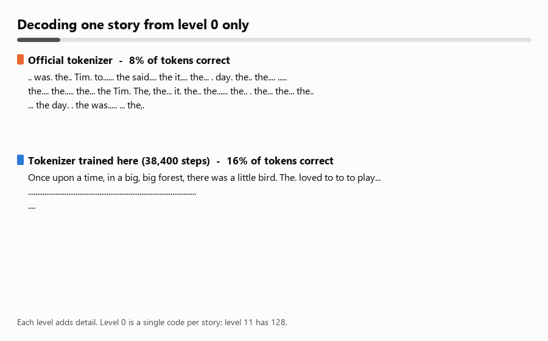
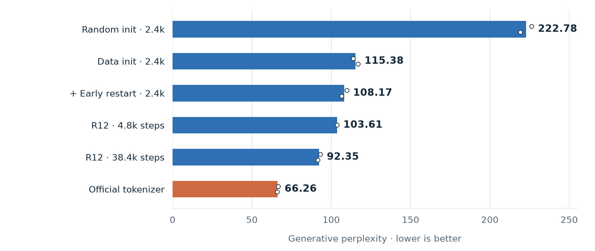
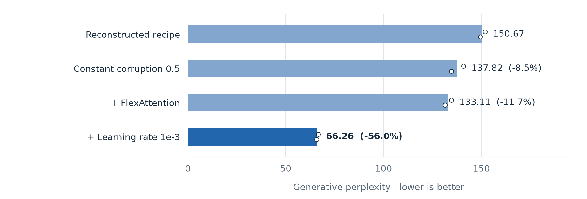

# Training a Next-Concept Model on a single 12 GB GPU

**Gianluca Meola** · Research note v0.1 · 20 November 2026  
[Read the paper (PDF)](paper/ncm-12gb.pdf) · [Experiments](EXPERIMENTS.md) · [Reproduce the results](REPRODUCING.md) · [Contact](mailto:gianluca.meola89@gmail.com)

**How far can a Next-Concept Model get on one consumer GPU?** This study trains the tokenizer and generator on TinyStories, tests practical choices at small budgets, and documents the remaining gap to the authors' released tokenizer. The main result is a reproducible account of what helps, with the unsuccessful interventions and raw runs included.

| Finding | Measured change | Scope |
|:---|:---|:---|
| Initialise codebooks from data | **48% lower Gen. PPL** | 222.78 → 115.38; two generator seeds, one tokenizer per configuration |
| Retune the short-budget generator | **56% lower Gen. PPL** | 150.67 → 66.26; two generator seeds, official tokenizer |
| Train our tokenizer longer | **A 1.39× gap remains** | 92.35 versus 66.26; two tokenizer seeds at the longest budget |

All three comparisons use a generator trained on **51,200 stories**. The last comparison uses different seed types on each side; details below. Gen. PPL is generative perplexity under GPT-2 large, **lower is better**. These percentages describe this metric, not equivalent percentage gains in general text quality.

> **Scope:** a study of training at small budgets on an RTX 3080 Ti (12 GB), not a full reproduction of the NCM paper. Maximum training exposure is 9.83M stories for our tokenizer and 0.41M for our generator, versus 122.88M and 102.4M reported in the paper. Stories seen are a data-exposure measure, not unique examples or a matched compute budget.

## What is an NCM?

[Next-Concept Models](https://arxiv.org/abs/2610.14162) generate text from coarse to fine. A VQ-VAE tokenizer compresses a story into a hierarchy of discrete codes. A separate generator learns to predict that hierarchy level by level, and the tokenizer's decoder turns the codes back into text.

<p align="center">
  <picture>
    <source media="(prefers-color-scheme: dark)" srcset="figures/coarse_to_fine_dark.gif">
    
  </picture>
</p>

The animation shows the hierarchy at work: one held-out story decoded from its first level only, then from more and more levels, with the official tokenizer and with the 38,400-step tokenizer trained here. It is **reconstruction of an encoded story**, not unconditional generation, and one example does not establish population-level quality.

For the released 12-level, 128-token configuration, level 0 is sampled from its empirical frequency and the generator predicts the remaining levels in **11 passes**. This pass count does not establish an equivalent wall-clock speedup over autoregressive generation. This study focuses on training and generated-text quality.

The authors released architecture code and checkpoints. Training code was not available in the sources checked for this study, so the training recipe here is a reconstruction with documented choices.

## 1. The largest tokenizer gain comes from data initialisation



With the generator recipe and budget fixed, initialising codebooks from data using k-means reduces Gen. PPL from **222.78 to 115.38 (−48.2%)**. Restarting dead codes only during the first 1,200 tokenizer steps reduces it further to **108.17 (−6.2%)**. Both comparisons average two generator seeds, but each tokenizer was trained only once.

The resulting recipe is called **R12** in this repository. Extending tokenizer training from 4,800 to 38,400 steps gives **103.61 → 92.35 (−10.9%)**. The longer setting has two tokenizer seeds, scoring 91.46 and 93.23 with the same generator training seed. The 4,800-step comparison has one tokenizer and one generator seed. The official tokenizer scores 66.26, averaged over two generator seeds: the remaining ratio is **1.39×**.

Snapshots of one long run score 95.15 at 9,600 steps and 90.27 at 19,200. They are checkpoints on one decaying learning-rate schedule, not independent shorter training runs or proof of a plateau.

Early-only code restarts are prior work, including [upstream PR #27](https://github.com/HazyResearch/ncm/pull/27); [issue #16](https://github.com/HazyResearch/ncm/issues/16) discusses restart behaviour and reconstruction versus generation. The contribution here is the measured downstream effect at these budgets, not the invention of that intervention.

## 2. A higher learning rate drives the generator recipe gain



On the frozen official tokenizer, at **400 steps × 128 stories**:

| Recipe | Gen. PPL | Change from baseline |
|:---|---:|---:|
| Reconstructed paper recipe: linear corruption 0.75 → 0.25, lr 3e-4 | 150.67 | — |
| Constant corruption 0.5 | 137.82 | −8.5% |
| + FlexAttention | 133.11 | −11.7% |
| + learning rate 1e-3 | **66.26** | **−56.0%** |

Each row averages two generator training seeds. Most of the gain arrives with the learning-rate change. The FlexAttention path also changes dropout behaviour relative to the baseline implementation, so its row is not an isolated test of an attention kernel's effect on quality.

At 102,400 stories, the complete recipe gives **74.82 → 43.84 (−41.4%)**, again with two seeds. This is evidence for the tested short budgets; its behaviour at full paper scale is unknown. Optimiser steps also matter: the reconstructed baseline reaches 83.16 when the same 51,200 stories are split into 800 steps × 64 rather than 400 × 128 (one seed).

## 3. More generator training improves both models, but leaves a gap


This experiment freezes **our 2,400-step R12 tokenizer**. It does **not** test the best 38,400-step tokenizer above.

| Generator stories seen | Official tokenizer | Our R12, 2,400 steps | Ratio |
|---:|---:|---:|---:|
| 51,200 | 66.26 (2 seeds) | 108.17 (2 seeds) | 1.63× |
| 102,400 | 43.84 (2 seeds) | 65.68 (1 seed) | 1.50× |
| 409,600 | **25.88 (2 seeds)** | **42.00 (2 seeds)** | **1.62×** |

An eightfold increase in generator exposure lowers perplexity substantially on both frozen tokenizers, while the relative gap persists. This does not rule out other generator recipes or longer training. The corresponding sweep on the 38,400-step tokenizer remains open.

The authors' complete released model scores **16.58** in this evaluation; the paper reports **15.41** for that model, an unexplained 7.6% difference. The paper also reports 9.67 for real text and 8.89 for its autoregressive baseline; those two values were not remeasured here.

## What the diagnostics suggest

**Better reconstruction does not reliably rank these tokenizers for generation.** Across ten evaluated tokenizers—eight training runs and two snapshots—mean code usage correlates more strongly with Gen. PPL (Spearman −0.90; −0.83 excluding the snapshots) than perfect-story reconstruction does (−0.48). This is a small, post-hoc comparison with exceptions, not a causal result or a replacement for training a generator.

**Level 0 behaves differently, but its role is unresolved.** Swapping its code changes 0.07% of decoded tokens in the official tokenizer, versus 4.0–5.5% in our R12 tokenizers trained at batch 256 for 4,800 steps or more (3.0% without level-0 normalisation). The animation above shows the same contrast on one story. Yet our batch-4,096 tokenizer also has an almost inert level 0 (0.05%) and still scores 100.36. An inert level 0 alone does not explain good generation.

The tested batch sizes, removal of level-0 normalisation, and an fp32/fp64 encoding difference in the official tokenizer did not eliminate the gap. Several tests have one seed. They narrow the investigation without establishing equivalence or ruling out entire explanations. Similar cross-entropy losses on different tokenizers also do not imply equal prediction quality: their target code distributions differ. See the [experiment record](EXPERIMENTS.md) for setups, counterexamples and limitations.

## Evaluation and reproducibility

Each model is evaluated on **1,280 unconditional stories**: 256 for each of five sampling seeds, using temperature 1 and no top-k or top-p truncation. The authors' evaluation scripts score the text with GPT-2 large. Sample entropy is a guard against repetitive output, not a substitute for judging text quality.

Training seeds and sampling seeds answer different questions. Most tokenizers have only one training seed; paired generator runs change initialisation while keeping data order fixed. The `±` values in the raw run report describe variation across sampling seeds of one trained model, **not uncertainty across independent training runs**.

The 12-level models have 36.4M tokenizer parameters and 88.6M generator parameters. A 51,200-story generator run takes about 10–12 minutes and peaks at 7.0 GiB of PyTorch-allocated memory on the study hardware. A 409,600-story run takes about 62–70 minutes; the longest tokenizer training takes about 3 h 15 min. These are local measurements, not portable speed guarantees.

Start with [REPRODUCING.md](REPRODUCING.md) for the environment, dependencies, exact commands, evaluation protocol and pause/resume details.

| Resource | What it contains |
|:---|:---|
| [Paper (PDF)](paper/ncm-12gb.pdf) | The illustrated research note |
| [EXPERIMENTS.md](EXPERIMENTS.md) | Questions, decision rules, results and conclusions for every experiment |
| [results/RUNS.md](results/RUNS.md) | 18 tokenizer runs, 77 evaluated generator runs, 5 interrupted or cancelled runs |
| [results/runs/](results/runs/) · [runs_index.csv](results/runs_index.csv) | Configurations, full logs, evaluation outputs and sample text |
| [configs/](configs/) · [tokenizer/](tokenizer/) · [generator/](generator/) | Experiment configurations and training code |
| [benchmarks/](benchmarks/) · [evaluation/](evaluation/) · [tests/](tests/) | Diagnostics, evaluation and technical checks |

## Checkpoints

The model package is prepared locally; Hugging Face publication is pending. Model weights are not included in this code repository. The planned package contains four checkpoints:

| Checkpoint | Intended use / measured result |
|:---|:---|
| R12 tokenizer, 38,400 steps, seed 42 | 91.46 with a separately trained 51,200-story generator |
| R12 tokenizer, 2,400 steps, seed 42 | Required tokenizer for the generator below |
| Generator on R12 **2,400-step** tokenizer, seed 42 | 409,600 stories; Gen. PPL **42.76** |
| Generator on the official tokenizer, seed 42 | 409,600 stories; Gen. PPL **26.04** |

**The package does not include a generator trained on the 38,400-step tokenizer.** Tokenizers and generators must use the matching learned code space; substituting the longer-trained tokenizer is not a valid upgrade. The official tokenizer remains a separate upstream dependency.

## Citation, credit and contact

Meola, G. (2026). *Training a Next-Concept Model on a single 12 GB GPU* (v0.1, research note).

```bibtex
@misc{meola2026ncm12gb,
  author = {Meola, Gianluca},
  title  = {Training a Next-Concept Model on a single 12 GB GPU},
  year   = {2026},
  note   = {v0.1, work in progress},
  url    = {https://github.com/janlu89/ncm-12gb}
}
```

[CITATION.cff](CITATION.cff) provides machine-readable citation metadata.

Built on [HazyResearch/ncm](https://github.com/HazyResearch/ncm) and the [NCM paper](https://arxiv.org/abs/2610.14162), with TinyStories data by Eldan and Li as pre-tokenised by the NCM authors. Upstream attribution and its pinned revision are in [NOTICE](NOTICE) and [third_party/README.md](third_party/README.md). Code is released under [MIT](LICENSE); see the upstream dataset card for data terms.

For replication questions, technical feedback or collaboration: **[gianluca.meola89@gmail.com](mailto:gianluca.meola89@gmail.com)**.
